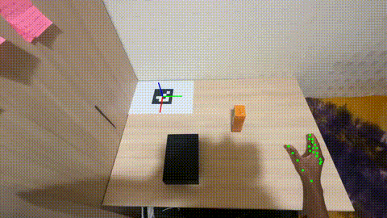
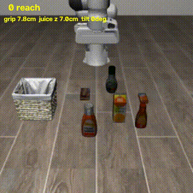
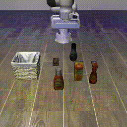
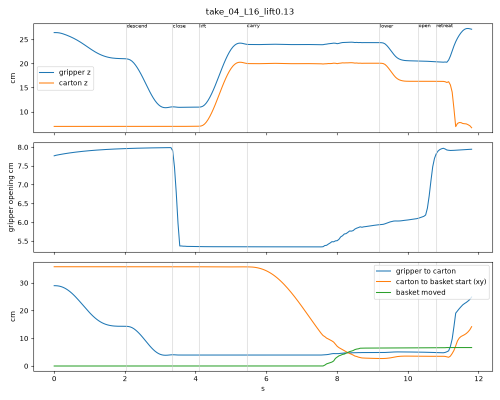
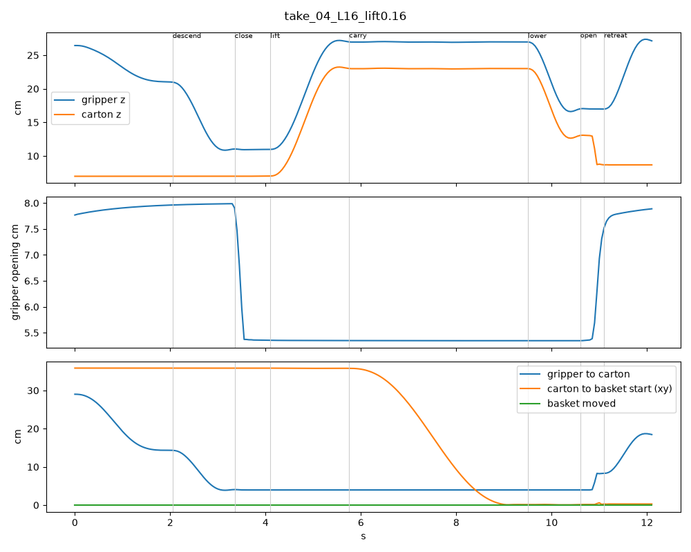
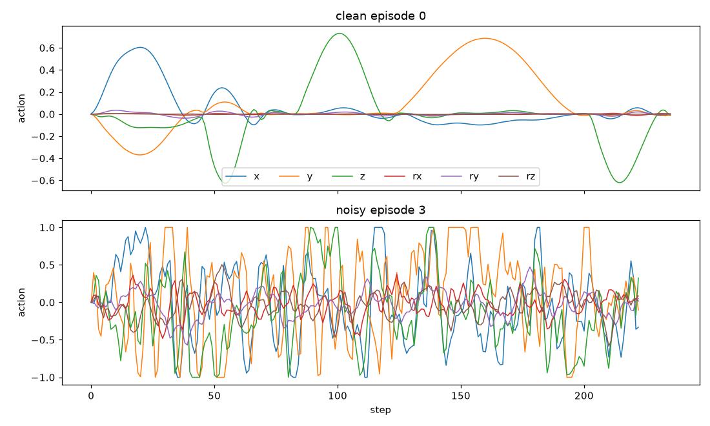
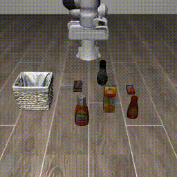

# From my head-mounted phone to a robot policy

**Humanoid Robot Learning Research internship challenge, October 2026.**

I recorded 48 videos of myself picking up a juice carton and putting it in a box, with an iPhone strapped to my head. This repository turns those videos into robot demonstrations in the LIBERO simulator and fine-tunes SmolVLA on them. The policy never sees my videos. My videos supply the motion; the simulator supplies the images.

| | |
|---|---|
| Task | LIBERO `libero_object` task 9: *pick up the orange juice and place it in the basket* (Franka Panda) |
| My data | 48 egocentric takes, 8–13 s each, one camera, no depth |
| Policy | SmolVLA (450M), fine-tuned from `lerobot/smolvla_base` |
| Result | **28% success** (14/50 episodes), smooth motion. Reference policy trained on LIBERO's robot data: 92%. |

| My take (what the phone sees) | Robot replaying it (training data) | Trained policy (v2) |
|---|---|---|
|  |  |  |

---

## 1. The idea in one paragraph

Human video and robot data differ in three ways. **Actions:** a video has no robot commands. **Body:** a hand is not a two-finger gripper. **Images:** the policy must see a robot arm, not mine. I recover the actions from my hand motion, reduce my hand to "where" and "open or closed", and replay that motion with the simulated robot, recording the simulator's own camera images. Every design choice below answers one of these three gaps.

### What's in this repository

| Path | Contents |
|---|---|
| `assets/samples/take_01.mp4`, `take_17.mp4`, `take_33.mp4` | Three of my raw takes, compressed to 640 px. The full 48 (1080p, about 0.7 GB) are not committed because of size. |
| `data/perception/take_XX_keyposes.jpg` | Every take's first frame with its detected rest, grasp and release points drawn on |
| `data/perception/take_XX_path.png` | Every take's measured hand path, height and finger opening |
| `data/perception/*_log.txt` | Per-take detection rates and keypose table |
| `data/camera_calib.npz` | My phone's calibration (0.5x lens, 1920×1080) |
| `assets/*.csv`, `assets/build_log*.txt` | Every replay attempt, the lift sweep and the dataset builds |
| `outputs/eval/*/eval_info.json` | Raw LIBERO evaluation results behind every table below |
| `outputs/train_log*.txt` | Both training runs, step by step |
| `patches/binarize_gripper.patch` | The only change made to LeRobot |

## 2. Pipeline

| Stage | What it does | Script |
|---|---|---|
| Record | iPhone 16 Pro on a head band, 1080p, 30 fps, 0.5x lens. A printed ArUco tag taped to the table. | — |
| Calibrate | Lens focal length and distortion from a ChArUco board video | `calibrate.py` |
| Perceive | Per frame: camera pose from the tag (`solvePnP`), 21 hand keypoints (MediaPipe) | `perceive.py` |
| Hand path | Hand in 3D in table coordinates, smoothed | `hand_path.py` |
| Keyposes | Grasp, release and rest points, phase timing, quality check | `keyposes.py` |
| Retarget + replay | Map keyposes onto the sim objects, plan a robot trajectory, track it in closed loop, keep successes | `build_dataset.py` |
| Diagnose | Classify why a replay failed, with labelled video and plots | `diagnose.py` |
| Train / evaluate | `lerobot-train`, `lerobot-eval` | commands below |

## 3. Perception: what worked and what didn't

**Calibration.** 124 board views, reprojection error **0.44 px**. My printer shrank the pages by about 5%, so I measured the printed sizes (tag 95 mm, board squares 33.2 mm) and used those.

**Camera pose from the tag.** After moving the tag behind the box so my arm never covers it, it was found in **96–100%** of frames in every take. My head moves about 7 cm sideways during a take; the tag cancels that out on every frame.

**Hand tracking.** MediaPipe found the hand in **83–100%** of frames. Short gaps (fingers hidden by the carton) are filled by interpolation.

**What failed: single-camera depth.** MediaPipe estimates how far away the hand is from its apparent size. That estimate wobbles by many centimetres from frame to frame. Measured on five test takes: path lengths of **175–461 cm** for a motion of roughly 1 m, lift heights of **24–44 cm** for lifts of about 10–15 cm, and in one take a start point 42 cm *below* the table. So I do not use the frame-by-frame 3D path.

**What replaced it: keyposes from known heights.** The direction from the camera to my fingertips is precise even when the distance is not. At three moments I know the height for physical reasons: my hand rests on the table, the grasp happens near the top of the carton, the release happens at the same height. Intersecting the precise viewing ray with that known plane gives an accurate 3D point without a depth guess.

**How I know it worked.** The box never moved between takes, so every release point should land in the same place. Across all 48 takes the release points have a spread of **2.7 cm × 2.6 cm**. I also draw each keypose back onto the first video frame as an independent visual check (`data/perception/take_XX_keyposes.jpg`).

**Quality gate.** A keypose is rejected if the nearest frame with a visible tag is more than 0.25 s away. In my first test session this correctly rejected a take where the camera pose had been interpolated across a 2.5 s gap and the grasp landed 15 cm off. In the final 48 takes, none were rejected.

**Known weakness.** In about 8 takes the grasp point lands beside the carton rather than on it, because I take it at the moment my fingers start closing, when the hand is sometimes still moving. Since the grasp is mapped onto the sim carton anyway, this only tilts the approach direction slightly.

## 4. Retargeting and replay

For each take, a rotation, scale and shift map my grasp point onto the sim juice and my release point onto the sim basket. My resting-hand position, mapped the same way, sets the direction the gripper approaches from. My reach and carry durations set the timing of each phase.

The robot follows quintic segments between waypoints, tracked with **feedforward plus feedback**: the planned step plus a correction for the measured error. I measured the controller before using it: full action moves the gripper about **0.98 cm per step**, the gripper takes about **10 steps to close** (so the plan pauses 15 steps before lifting), and the arm sags slightly under open-loop commands (hence the feedback).

Constraints added after measuring failures:
- **Speed limit 18 cm/s peak**, just under what the arm can track.
- **Episode budget:** LIBERO stops an episode at 280 steps. Demos longer than 270 are not saved.
- **Training layouts 10–49 only.** Layouts 0–9 are held out for evaluation.

### Finding: my box is lower than the sim basket

My first replays failed on 11 of 48 takes, always the same takes. The diagnosis tool first said "no problem detected". Watching the videos showed the carton hitting the basket wall while carrying, pushing the basket away, and the robot releasing over the empty spot. My tool had excluded the basket from its collision check. After fixing that, a sweep on two failing takes:

| Lift above grasp | Carton height while carrying | Result |
|---|---|---|
| 13 cm | 20.3 cm | both fail: basket hit at step ~156, moved 7–10 cm |
| 14 cm | 21.2 cm | both succeed |
| 15–19 cm | 22–26 cm | both succeed |

| 13 cm lift: carton hits the basket, basket moves | 16 cm lift: clean carry |
|---|---|
|  |  |

The threshold is between 13 and 14 cm. I set the floor at **16 cm** (2 cm margin). My real box is 5 cm tall, so my real lifts never needed to be this high. **This is a scene gap:** my demonstrations supply where and when; the simulator's geometry dictates how high.

With that floor, **all 48 takes replay successfully** (96/96 across two layouts each).

## 5. Training and evaluation

### First attempt: 12%

The first dataset had 48 clean replays plus 31 replays with noise injected into the robot's actions (DART-style), meant to teach recovery from errors. SmolVLA trained for 15,000 steps (batch 16, 3 h 43 min, 5.8 GB GPU memory). The loss fell from 2.48 to 0.36.

Evaluated on 50 episodes:

| Policy | Held-out layouts 0–9 | Layouts 10–49 | All |
|---|---|---|---|
| Mine, v1 | 3/10 | 3/40 | **6/50 (12%)** |
| `HuggingFaceVLA/smolvla_libero` (LIBERO robot data) | 9/10 | 37/40 | **46/50 (92%)** |

In the videos my policy's arm shook the whole time, yet it still headed for the juice, grasped and carried. The reference moved smoothly.

### Diagnosis: I had taught it to shake

I measured how much the action label changes from one step to the next:

| Episodes | Position | Rotation |
|---|---|---|
| Clean (48) | 0.014 | 0.001 |
| Noisy (31) | **0.253** | **0.075** |

The noisy labels were 18× jerkier in position and 75× in rotation:



I had added a new random push of 30% of full action at every step. The arm trembled in those episodes, and the labels, which correct for the current error, swung with it. 40% of the training data showed shaking as normal behaviour, and the model learned it faithfully.

The DART paper chooses the noise level to match the trained policy's own errors. Mine was far larger, and white rather than smooth.

I also tested executing all 50 planned actions before re-planning (instead of 10). Success dropped to 0/10. So re-planning was not causing the shaking, and frequent re-planning is what lets the policy correct itself.

### Second attempt: clean data only

Rebuilt with 96 clean replays (two layouts per take), checked the labels **before** training (jerk 0.014 mean, 0.016 max), and fine-tuned for 8,000 steps.

| Policy | Held-out layouts 0–9 | Layouts 10–49 | All |
|---|---|---|---|
| Mine, v1 (with noisy data) | 3/10 | 3/40 | 6/50 (12%) |
| **Mine, v2 (clean only)** | **4/10** | **10/40** | **14/50 (28%)** |
| Reference (LIBERO robot data) | 9/10 | 37/40 | 46/50 (92%) |

Training v2: 8,000 steps, batch 16, 2 h 1 min, loss 1.60 → 0.09.

**The shaking is gone in every evaluation video.** The remaining failures, from watching the ten held-out episodes:

| Episodes | What happened |
|---|---|
| 0, 1, 5, 8 | Success |
| 2, 3 | Grasped, then moved sideways without lifting, released early or crawled slowly |
| 4, 7 | Knocked the carton over while approaching |
| 6 | Carton centred between the fingers, but the gripper never closed fully |
| 9 | Moved over the carton without grasping |



**Caveat on this comparison:** v2 changes two things at once (no noisy episodes, and more clean ones), so the table alone cannot say which change mattered. The label measurement above is what points at the noise.

### How often to re-plan

The policy predicts 50 actions at a time. I chose beforehand to execute 10 and then re-plan, and tried the alternatives only as extras:

| Actions executed per plan | Held-out success |
|---|---|
| 5 (v2) | 1/10 |
| **10 (v2, main result)** | **4/10** |
| 50 (v1, the shaky model) | 0/10 |

Ten is the best of the three. The 50-step row was measured on the v1 model, so it is a weaker comparison than the other two. Re-planning too rarely lets errors build up; re-planning too often seems to make the policy switch between plans.

### Snapping the gripper command (inference only, decided after seeing the failures)

In several failures the gripper looked as if it were hovering half-closed around a centred carton. One possible cause: the policy's gripper output is a continuous value between "open" (−1) and "closed" (+1), and the simulator treats an in-between value as partly closed. Snapping it to the nearer of the two is common in LIBERO evaluations, so I tested it. It needs no retraining: a four-line change in LeRobot's environment wrapper ([`patches/binarize_gripper.patch`](patches/binarize_gripper.patch)), switched on with `BINARIZE_GRIPPER=1`.

| Policy | Held-out 0–9 | Layouts 10–49 | All |
|---|---|---|---|
| v2 | 4/10 | 10/40 | 14/50 (28%) |
| v2 + snapped gripper | 4/10 | 10/40 | 14/50 (28%) |

**No change at all.** So in the failing episodes the gripper command was already on the "open" side, and snapping kept it open. The policy is not hovering half-closed; it is *deciding* not to close. That is a problem of learning when to grasp, which no change at evaluation time can fix. I keep the patch in the repository because it rules this explanation out.

## 6. Honest limitations

- **Weak generalisation test.** In this task the juice never moves between layouts and the basket shifts only 1–2 cm. "Held-out layouts" says little about generalisation.
- **Unequal comparison.** The reference policy was trained on LIBERO's teleoperation data for many tasks. Mine was trained on one task from 48 phone videos.
- **How much of my data reaches the robot.** Grasp and release are pinned to the sim objects. My data sets the approach direction, the phase structure and timing (where I was slower than the robot's speed limit), and which layouts are covered. My lift height does not reach the robot; the sim's geometry decides it.
- **Single-camera depth** was too noisy for the full hand path (section 3).
- **One task.**

## 7. What I would do next

1. **Smooth, small noise injection.** Slowly drifting noise at about 5% of full action, so the demos show recovery without shaking.
2. **Self-improvement loop.** Run the policy on training layouts, keep its own successful rollouts, fine-tune again. A simple form of learning from reward.
3. **Detect the carton in the first frame** (it is bright orange), so my grasp point on the carton and release point in the box carry over exactly.
4. **Wrist rotation** from the thumb–index direction, for objects not aligned with the gripper.
5. **More tasks** with objects I already have: ranch bottle → LIBERO "salad dressing", bowl and plate → "put the bowl on the plate".
6. **Faster inference:** fewer flow-matching steps (10 → 5), measured as success versus time.
7. **Check data before every training run.** The jerk check took two minutes and would have saved a 3.7-hour run.
8. **More grasp-moment data.** The main remaining failure is the policy not deciding to close. Replays that start right next to the carton, from slightly different positions, would put more weight on that moment.

## 8. Reproduce

Hardware used: Ubuntu 24.04, RTX 4060 laptop (8 GB), NVIDIA driver 535.

```bash
# environments (two, so the hand tracker cannot disturb LeRobot's versions)
python3 -m venv .venv && source .venv/bin/activate
pip install torch==2.10.0 torchvision==0.25.0 torchcodec==0.10.0
git clone https://github.com/huggingface/lerobot.git    # tested at 8c920c42 (v0.6.2)
pip install -e "./lerobot[libero,smolvla]"
deactivate
python3 -m venv .venv_percep && source .venv_percep/bin/activate
pip install mediapipe matplotlib scipy
```

**Without my raw videos:** the full 48 takes are not in the repository, but the perception output the dataset builder needs, `data/perception/keyposes.npz`, is. So you can skip straight to the dataset step below and reproduce everything from there.

```bash
# perception (.venv_percep), needs the raw videos in data/raw and data/takes
python calibrate.py data/raw/calib.mov 33.2
for f in data/takes/take_*.mov; do python perceive.py "$f" 95; done
for n in $(seq -w 1 48); do python hand_path.py take_$n 95; done
python keyposes.py 10.5

# dataset (.venv, MUJOCO_GL=egl)
python build_dataset.py --noise 0 --lift_min 0.16 --lift_max 0.19 \
  --root data/lerobot_dataset_clean --repo_id local/hmnd_ego_oj_clean
```

```bash
# training (.venv), about 2 h on an RTX 4060 laptop
lerobot-train \
  --policy.path=lerobot/smolvla_base \
  --policy.empty_cameras=1 \
  --rename_map='{"observation.images.image": "observation.images.camera1", "observation.images.image2": "observation.images.camera2"}' \
  --dataset.repo_id=local/hmnd_ego_oj_clean --dataset.root=data/lerobot_dataset_clean \
  --batch_size=16 --steps=8000 --save_freq=2000 --num_workers=4 \
  --policy.device=cuda --policy.push_to_hub=false --wandb.enable=false \
  --output_dir=outputs/train/smolvla_ego_oj_clean

# evaluation: 50 episodes; episode i uses LIBERO start layout i (0-9 never used in training)
MUJOCO_GL=egl lerobot-eval \
  --policy.path=outputs/train/smolvla_ego_oj_clean/checkpoints/008000/pretrained_model \
  --policy.n_action_steps=10 --policy.device=cuda \
  --rename_map='{"observation.images.image": "observation.images.camera1", "observation.images.image2": "observation.images.camera2"}' \
  --env.type=libero --env.task=libero_object --env.task_ids="[9]" \
  --env.observation_height=256 --env.observation_width=256 \
  --eval.batch_size=1 --eval.n_episodes=50 --seed=1000 \
  --output_dir=outputs/eval/ego_clean_8000
python score.py ego_clean_8000      # splits held-out and training layouts

# reference: same command with --policy.path=HuggingFaceVLA/smolvla_libero and no --rename_map
```

The camera rename and the empty third camera slot are needed because `lerobot/smolvla_base` was pretrained with three cameras named `camera1` to `camera3`.

## Acknowledgements

LeRobot and SmolVLA (Hugging Face), LIBERO, MuJoCo, robosuite, MediaPipe, OpenCV. Ideas from EgoMimic, HumanEgo, Ego2Robot, Phantom, H2R and DART.
